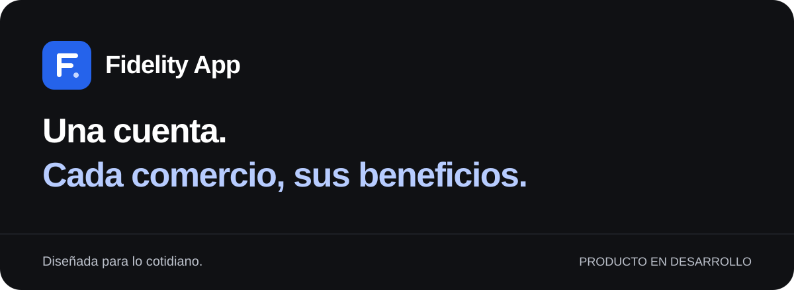
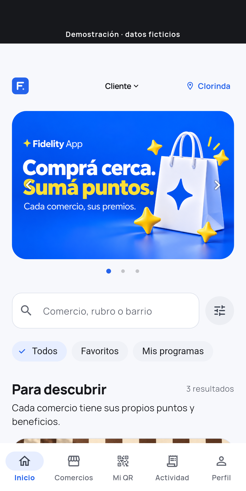
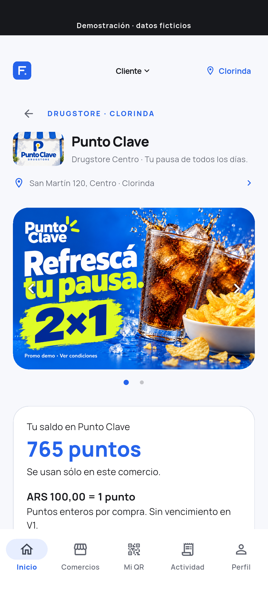
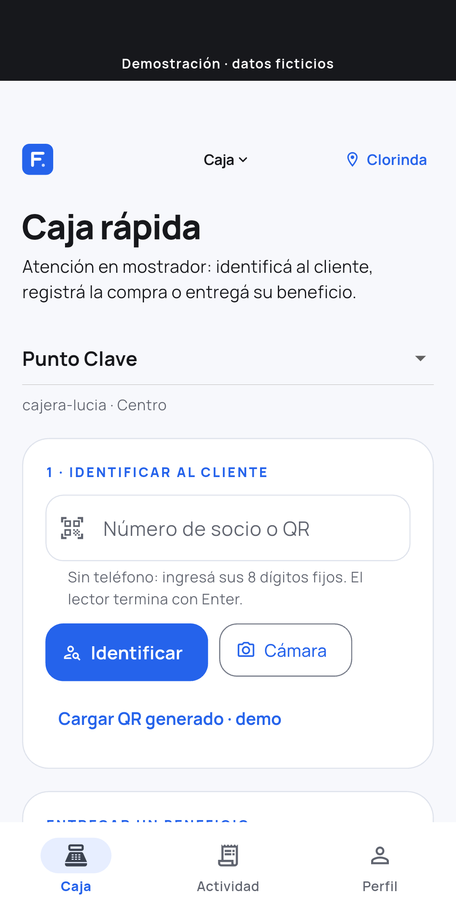
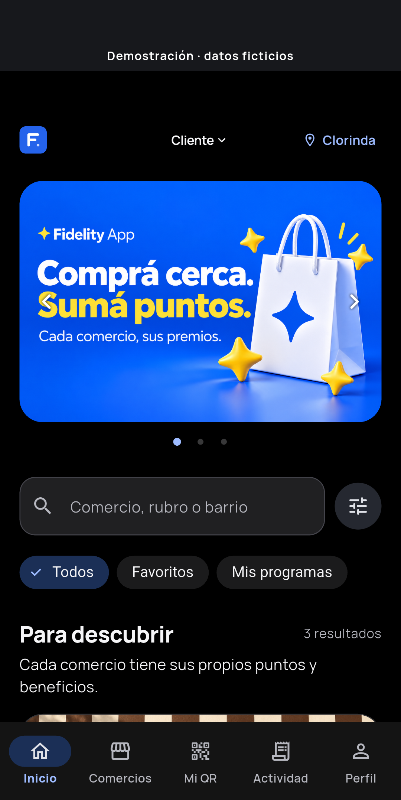

<strong>Fidelización para los comercios que forman parte de tu día.</strong> Una aplicación móvil para descubrir negocios, consultar tus puntos y usar sus beneficios.

Flutter · Android · iOS en preparación · Producto en desarrollo

## Una cuenta, muchos comercios

Fidelity App reúne programas de fidelidad de distintos negocios en una experiencia simple. Cada comercio conserva sus puntos, premios, ofertas e identidad. Los puntos de una cafetería se usan en esa cafetería: no hay una bolsa global.

El cliente tiene una sola cuenta y un número de socio fijo. El personal autorizado puede identificarlo y registrar una compra; para entregar un beneficio se utiliza una autorización temporal específica.

## Un vistazo a la experiencia

Capturas de **Fidelity App 0.6.2+11 · demo Android · 21/10/2026**, ejecutada en emulador. Comercios, personas y promociones ficticios; piloto cerrado. Podés abrir cada imagen para verla completa.

  
  

**Descubrir y elegir.** Búsqueda, filtros y favoritos para encontrar cada negocio. El saldo y los beneficios siempre pertenecen al comercio correspondiente.

  
  

**Operar y seguir.** La caja distingue identificación, compra y entrega de beneficios. Modo claro, oscuro y respeto por la reducción de movimiento.

## Del cliente al comercio

| Para quien compra | Para el negocio |
|---|---|
| Descubrir comercios y guardar favoritos | Identificar socios y acreditar compras |
| Consultar puntos, premios e historial | Confirmar beneficios y administrar stock |
| Ver ofertas y condiciones de cada programa | Gestionar catálogo, imágenes y campañas |
| Mostrar identidad y autorizaciones temporales | Trabajar con cuentas individuales y permisos |

La plataforma administra las altas de comercios y el contenido destacado de inicio. La selección libre de roles que aparece en las capturas pertenece a la demostración.

## Cuidar los detalles

La dirección visual prioriza lectura, jerarquía y navegación predecible: azul como acento, superficies claras, negro en modo oscuro y espacio para la identidad de cada comercio. Las imágenes publicitarias se muestran completas y los controles conservan etiquetas y áreas cómodas para tocar.

Se estudiaron guías de Android y Apple, investigación de usabilidad y productos de referencia. [Leer los criterios de diseño](DESIGN.md).

## Estado del proyecto

Hay una demo funcional y un entorno de desarrollo conectado. Favoritos completos, catálogos paginados y un editor administrativo de reglas se comprueban con pruebas locales, servidor y emulador Android. La continuación **0.6.3** agrega recuperación de fotos pendientes y diagnóstico técnico local: se consulta el resultado antes de reenviar, con estados claros y sin continuar automáticamente el trabajo de otra cuenta. No promete transferencias en segundo plano.

Las capturas de arriba siguen mostrando la **demo0.6.2** y no dan acceso al entorno conectado. La preparación para iOS está incluida en el proyecto; la compilación y prueba física en iPhone siguen pendientes. Tampoco se atribuyen resultados de emulador a teléfonos físicos. No se presenta como una aplicación ya publicada en tiendas ni como un piloto abierto a clientes reales.

## Sobre este repositorio

Proyecto de [Dante Santino Paolisso](https://github.com/dantesantinopaolisso). Tecnologías del producto: Flutter, Dart, Supabase y PostgreSQL.

Este espacio contiene exclusivamente presentación y capturas sintéticas. El código del producto y la documentación interna se mantienen en un repositorio privado. No se incluyen datos de clientes, credenciales ni detalles operativos. Las marcas de comercios mostradas son ejemplos de demostración; no implican relaciones comerciales.

Las observaciones sobre la presentación pueden registrarse en Issues, sin incluir información personal ni credenciales. [Cómo aportar](CONTRIBUTING.md).
